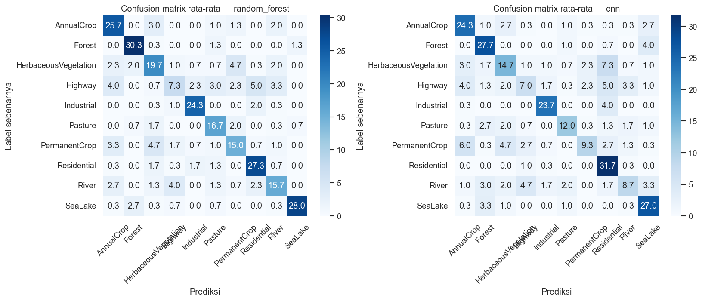
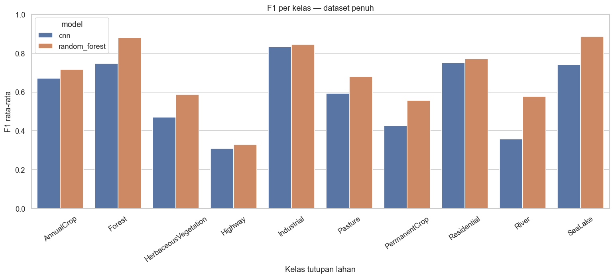
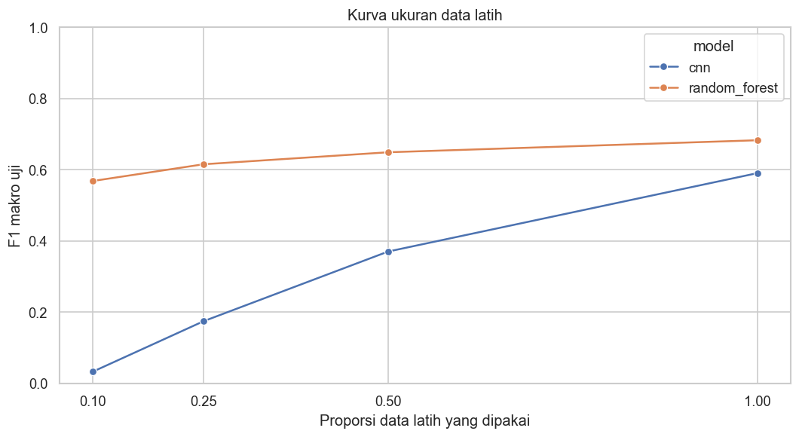
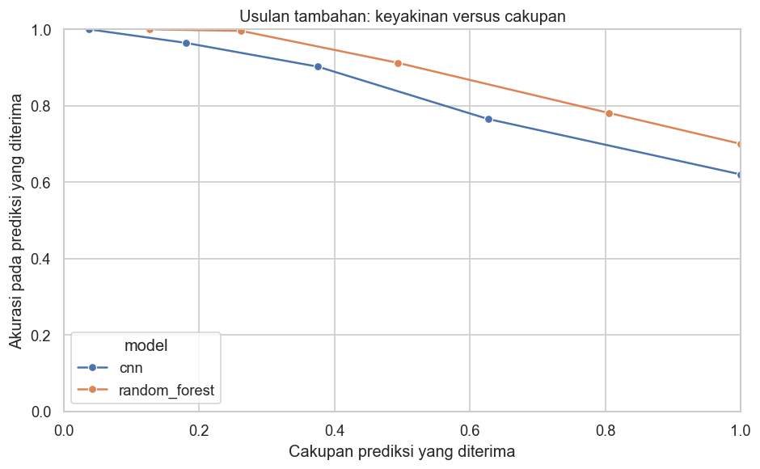

# Perbandingan Random Forest dan CNN untuk Klasifikasi Citra EuroSAT

Studi kasus ini membandingkan baseline fitur statistik + Random Forest dengan CNN kecil PyTorch pada subset EuroSAT RGB, yaitu citra Sentinel-2 berlabel **tutupan lahan**.

> **Catatan penting:** studi ini **TIDAK mereproduksi hasil narasumber**. Dataset EuroSAT yang dipakai berlabel tutupan lahan, bukan pemicu langsung deforestasi, dan mirror yang digunakan hanya memuat satu versi optik RGB. Yang diadaptasi hanyalah pendekatan metodologis: membandingkan metode konvensional dengan deep learning, mengevaluasi per kelas, mengamati kelas yang tertukar, dan membandingkan kebutuhan data serta waktu komputasi. **Angka hasil tidak boleh dibandingkan dengan angka seminar.**

## Latar belakang dan batas hubungan ke materi

Seminar **“Attributing Direct Drivers to Deforestation Alerts with Satellite Imagery and AI”** oleh Dr. Bart Slagter (Wageningen University and Research) menjelaskan bahwa alert satelit menunjukkan lokasi gangguan, bukan otomatis penyebabnya; pemicu langsung diklasifikasi dari contoh berlabel; model dapat keliru dan memiliki label “tidak yakin”; metode konvensional disarankan sebagai pembanding sebelum deep learning; serta data satelit dan kelas generik tidak cukup untuk mengetahui penyebab sebenarnya.

Eksperimen ini menerapkan perbandingan RF/CNN pada tugas citra lain. Ia **tidak** mengidentifikasi pertanian, jalan, penebangan, pertambangan, kebakaran, banjir, atau penyebab deforestasi.

## Dataset dan pemeriksaan versi

Kode menggunakan mirror publik [nielsr/eurosat-demo](https://huggingface.co/datasets/nielsr/eurosat-demo), arsip `train-00000-of-00001.parquet` dengan revision `61bab8317ee7f13bea1831f2ec3a7fa571a01a81`. Versi upstream dan penjelasan RGB/multispektral tersedia pada [repositori EuroSAT](https://github.com/phelber/EuroSAT). Arsip yang diunduh diperiksa langsung dengan PyArrow dan Pillow sebelum eksperimen.

| Properti terverifikasi | Nilai |
|---|---|
| Dataset penuh pada mirror | 27.000 citra, 10 kelas |
| Berkas yang diunduh | Parquet, 88.441.801 byte |
| Versi eksperimen | RGB mirror, bukan versi 13-band |
| Ukuran citra | 64 × 64 piksel |
| Pita yang tersedia | 3: Red, Green, Blue |
| NDVI | Tidak dihitung: tidak ada pita NIR pada versi RGB |
| Subset eksperimen | 2.000 citra, stratified, seed subset 20261020 |
| Perangkat run terakhir | AMD Ryzen 7 5700U, 8 core fisik / 16 logical processor, RAM terpasang 24 GB |
| Sistem dan runtime | Windows 11 Home, Python 3.11.9, PyTorch 2.14.1+cpu |

Distribusi kelas dataset penuh diperoleh dari metadata mirror dan diverifikasi dengan label Parquet:

| Kelas | Citra |
|---|---:|
| AnnualCrop | 3.000 |
| Forest | 3.000 |
| HerbaceousVegetation | 3.000 |
| Highway | 2.500 |
| Industrial | 2.500 |
| Pasture | 2.000 |
| PermanentCrop | 2.500 |
| Residential | 3.000 |
| River | 2.500 |
| SeaLake | 3.000 |

Distribusi subset 2.000 citra (hasil pilihan seed berstrata) dan metadata aktual lain tersimpan di [`reports/dataset_metadata.json`](reports/dataset_metadata.json). Arsip raw tidak disimpan dalam repositori; direktori `data/raw/` diabaikan Git.

## Alur eksperimen

1. Unduh Parquet EuroSAT RGB; verifikasi jumlah citra, label, mode, ukuran, dan jumlah pita.
2. Pilih subset berstrata 2.000 citra.
3. Buat split stratified train/validation/test **70%/15%/15%** dengan tiga seed (11, 23, 37). ID citra pada ketiga split diperiksa agar tidak tumpang tindih.
4. Random Forest menerima 45 fitur/citra: mean, simpangan baku, kuantil 10/25/50/75/90, dan 8-bin histogram untuk masing-masing pita RGB. Tidak ada NDVI.
5. CNN kecil dengan 3 blok konvolusi dilatih pada data mentah RGB; augmentasi train berupa flip dan rotasi 90°, early stopping menggunakan loss validation.
6. Bandingkan model mayoritas, RF, dan CNN menggunakan accuracy, precision, recall, F1 per kelas dan macro, confusion matrix, waktu latih, waktu inferensi, serta kurva ukuran data latih.
7. **Usulan tambahan, bukan poin materi:** evaluasi ambang confidence untuk memberi status “tidak yakin” dan menghitung trade-off coverage/accuracy. Ini adalah abstensi simulasi, bukan klaim bahwa prediksi benar.

Konfigurasi lengkap dan hiperparameter ada di [`config.yaml`](config.yaml). Model tidak memakai validation/test untuk belajar; seluruh data masuk ke split berdasarkan ID citra yang berbeda.

## Instalasi dan menjalankan

Python 3.10+ direkomendasikan. Langkah berikut memakai PowerShell dari folder proyek:

```powershell
python -m venv .venv
.\.venv\Scripts\Activate.ps1
python -m pip install -r requirements.txt
python -m unittest discover -s tests -v
python -m src.data_loader --download
python -m src.main --subset-size 500 --seeds 1
```

Perintah terakhir adalah **smoke test** singkat. Untuk menjalankan laporan final yang memakai 2.000 citra dan tiga seed:

```powershell
python -m src.main
```

Eksperimen final yang tercatat di README dijalankan pada CPU tanpa GPU. Run terakhir selesai dalam 157,1 detik (wall-clock seluruh eksperimen). Waktu dapat berubah menurut prosesor dan jumlah thread; waktu model per konfigurasi dilaporkan di `reports/hasil_per_seed.csv`. Pengunduhan pertama memerlukan sekitar 85 MiB.

Untuk mengganti ukuran subset:

```powershell
python -m src.main --subset-size 3000
```

Ukuran subset dan hasil setiap eksekusi ditulis ke metadata; jangan menyamakan hasil subset yang berbeda.

## Hasil eksperimen aktual

Tabel memakai hasil `test` dengan seluruh data latih (fraction 1.0), rata-rata ± simpangan baku tiga seed. Angka ini menggambarkan konfigurasi subset dan split yang tercatat, bukan kinerja umum atau hasil seminar.

| Model | Accuracy | Precision macro | Recall macro | F1 macro | Waktu latih (detik) | Waktu inferensi (detik/test) | Ukuran/model kompleksitas |
|---|---:|---:|---:|---:|---:|---:|---|
| Baseline mayoritas | 0,1111 ± 0,0019 | 0,0111 ± 0,0002 | 0,1000 ± 0,0000 | 0,0200 ± 0,0003 | 0,000 ± 0,000 | 0,000083 ± 0,000008 | 0 parameter terlatih |
| Random Forest | 0,7000 ± 0,0351 | 0,6845 ± 0,0342 | 0,6930 ± 0,0347 | 0,6826 ± 0,0345 | 2,886 ± 0,697 | 0,506 ± 0,143 | 150 pohon; ~87.205 simpul total ± 1.046 |
| CNN kecil | 0,6200 ± 0,0186 | 0,6375 ± 0,0244 | 0,6061 ± 0,0196 | 0,5901 ± 0,0202 | 22,617 ± 2,232 | 0,214 ± 0,043 | 24.458 parameter |

Pada run ini Random Forest memperoleh skor rata-rata lebih tinggi daripada CNN pada subset yang diuji, dengan waktu latih yang lebih singkat. Waktu inferensi RF mencakup ekstraksi fitur dari citra dan prediksi model. Ini hasil eksperimen khusus ini, bukan bukti RF selalu lebih unggul. RF tidak memiliki jumlah parameter terlatih yang sebanding langsung dengan parameter neural network; CSV mencatat ukuran kompleksitasnya sebagai jumlah simpul pohon, sedangkan parameter CNN adalah jumlah bobot trainable.

### Grafik hasil









### Kurva ukuran data latih

Setiap titik mengukur F1 makro pada split test yang sama, dengan jumlah data train bervariasi; angka adalah mean dari tiga seed. Ukuran train penuh adalah 1.400 citra.

| Fraksi data train | Jumlah train | RF F1 macro | CNN F1 macro |
|---:|---:|---:|---:|
| 10% | 140 | 0,5680 ± 0,0221 | 0,0321 ± 0,0238 |
| 25% | 350 | 0,6150 ± 0,0340 | 0,1739 ± 0,1374 |
| 50% | 700 | 0,6487 ± 0,0258 | 0,3698 ± 0,2767 |
| 100% | 1.400 | 0,6826 ± 0,0345 | 0,5901 ± 0,0202 |

Pada subset dan arsitektur ini skor CNN meningkat saat lebih banyak data latih tersedia, tetapi masih di bawah RF bahkan pada 100%. Kesenjangan besar dan variasi CNN pada fraksi 25–50% menunjukkan hasil sensitif terhadap seed/data yang tersedia; tidak ada pemaksaan klaim keunggulan CNN.

### Kelas yang sering tertukar

Menggabungkan salah klasifikasi pada test tiga seed, pasangan teratas dalam hasil ini:

| Model | Label aktual → prediksi | Jumlah salah klasifikasi |
|---|---|---:|
| RF | HerbaceousVegetation → PermanentCrop | 14 |
| RF | PermanentCrop → HerbaceousVegetation | 14 |
| RF | Highway → Residential | 13 |
| CNN | HerbaceousVegetation → Residential | 19 |
| CNN | PermanentCrop → AnnualCrop | 16 |
| CNN | Highway → Residential | 13 |

Dugaan bahwa pasangan vegetasi/panen memiliki tekstur atau pola spektral mirip, dan jalan/permukiman memiliki elemen buatan yang menyerupai satu sama lain, adalah **interpretasi visual** yang belum dibuktikan melalui analisis lapangan atau inspeksi sistematis citra. Lihat seluruh daftar pasangan di `reports/detail_evaluasi.csv`.

### Usulan tambahan: prediksi “tidak yakin”

Ambang confidence bukan bagian yang dinyatakan untuk eksperimen ini di materi; ini **usulan implementasi** yang meniru ide abstensi. Pada threshold 0,80, rerata tiga seed pada data latih penuh adalah:

| Model | Threshold | Coverage | Akurasi pada prediksi diterima |
|---|---:|---:|---:|
| RF | 0,80 | 0,262 ± 0,004 | 0,996 ± 0,007 |
| CNN | 0,80 | 0,180 ± 0,082 | 0,964 ± 0,062 |

Angka menunjukkan hanya sebagian prediksi yang dipertahankan. Nilai confidence bukan jaminan kebenaran, dan pengguna tetap perlu mempertimbangkan label “tidak yakin”.

## Waktu dan biaya komputasi

Run yang dilaporkan menggunakan perangkat CPU tanpa GPU; gunakan metadata/CSV untuk melihat per seed. Pada model penuh, CNN memiliki 24.458 parameter dan memerlukan rata-rata sekitar 22,6 detik pelatihan; RF membutuhkan sekitar 2,9 detik termasuk ekstraksi fitur dan fit. Inferensi RF sedikit lebih lama pada pengukuran ini karena ekstraksi fitur citra diukur bersama prediksi; CNN menerima tensor citra langsung. Angka waktu sangat dipengaruhi perangkat, thread, cache, dan beban lain.

## Keterbatasan dan interpretasi

- Dataset memakai satu sensor optik RGB saja; mirror ini tidak memuat pita NIR, sehingga NDVI tidak dihitung. EuroSAT multispektral 13-band adalah versi berbeda dan **tidak** dipakai pada laporan ini.
- Label adalah 10 kelas tutupan lahan generik, bukan kelas pemicu deforestasi langsung.
- Hanya subset stratified 2.000 dari 27.000 citra digunakan pada hasil final.
- CNN berukuran kecil dan hiperparameter tidak dituning secara ekstensif; eksperimen tanpa GPU.
- Tidak ada validasi lapangan, konteks temporal, data radar Sentinel-1, atau verifikasi penyebab gangguan.
- Hasil tidak dapat menentukan penyebab lokal dari alert deforestasi dan tidak boleh disajikan sebagai atribusi driver.
- Dugaan alasan salah klasifikasi merupakan interpretasi, bukan temuan sebab-akibat yang teruji.
- Skor/kurva confidence adalah usulan eksperimen dan bukan jaminan probabilitas yang terkalibrasi.

## Pelajaran utama

Metode konvensional layak menjadi baseline yang kuat; model yang lebih kompleks tidak otomatis lebih akurat. Perbandingan perlu mencakup metrik per kelas, data yang digunakan, waktu, serta kesalahan yang sering terjadi. Yang terpenting untuk konteks seminar: citra/alert dan kelas tutupan lahan tidak cukup untuk menyimpulkan pemicu deforestasi.

## Berkas laporan

- `reports/hasil_per_seed.csv`: metrik model, seed, ukuran train, waktu latih/inferensi.
- `reports/ringkasan.csv`: mean dan simpangan baku metrik/waktu.
- `reports/detail_evaluasi.csv`: metrik per kelas, confusion matrix, dan kelas tertukar dalam JSON.
- `reports/cakupan_vs_akurasi.csv`: hasil usulan threshold confidence.
- `reports/metadata.json`: subset, split IDs, versi pustaka, hiperparameter, dan perangkat.
- `reports/dataset_metadata.json`: sumber, karakteristik data, dan distribusi kelas.
- `reports/figures/`: confusion matrix, F1 per kelas, learning curve, dan coverage/accuracy.

